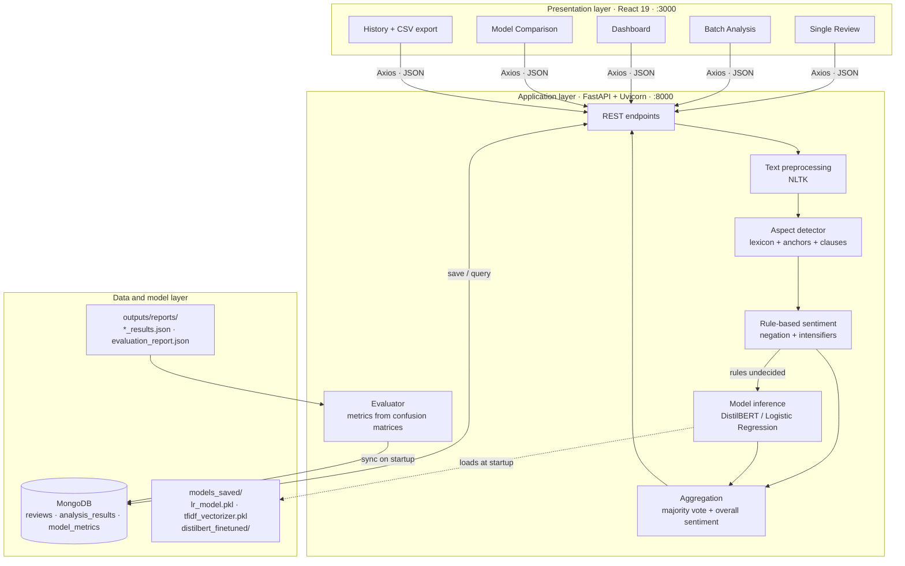
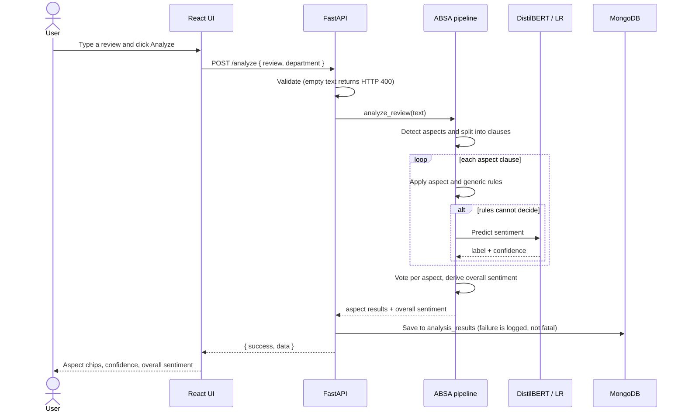
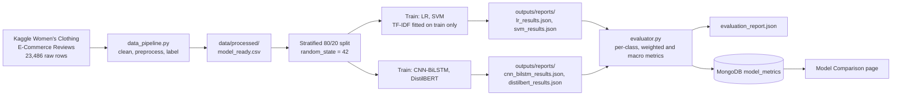
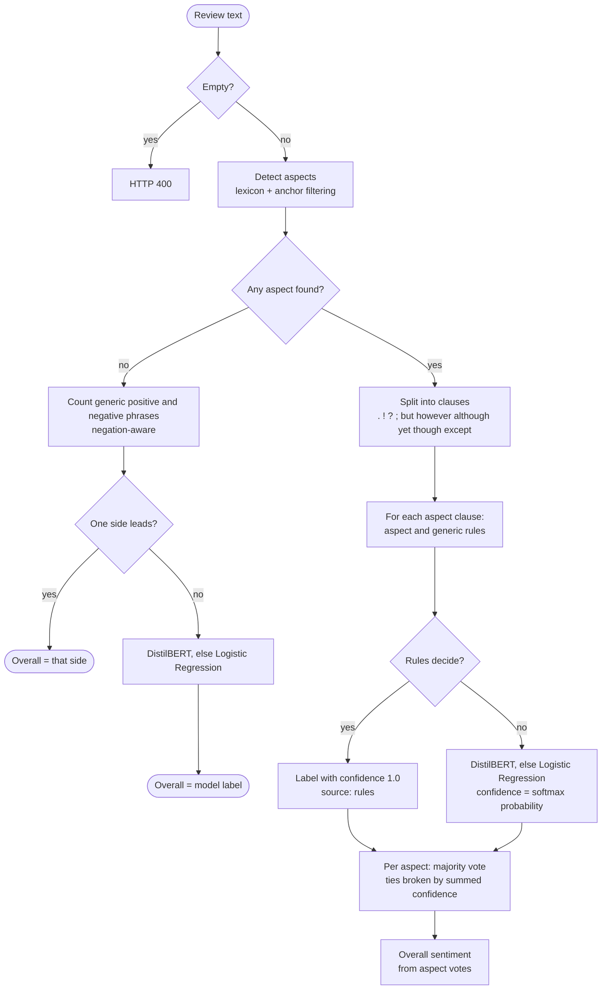

# 🛍️ ABSA — Aspect-Based Sentiment Analysis of E-Commerce Clothing Reviews


A full-stack system that reads women's clothing reviews and tells you **what customers felt about each part of the product**, not just whether the review is good or bad overall.

> *"The fabric is lovely but the size runs really small."*
> → **Fabric: Positive** · **Size: Negative** · Overall: **Neutral** (mixed)

The project combines a **rule-based aspect engine** (lexicon, anchor words, clause splitting, negation handling) with **machine-learning and deep-learning classifiers** (Logistic Regression, Linear SVM, CNN-BiLSTM with attention, DistilBERT), served through a **FastAPI** backend, stored in **MongoDB**, and explored through a **React** dashboard.

**Major Project Phase 2 · Team Double.exe · Department of CSE, ATME College of Engineering, Mysuru**

---

## Table of contents

1. [Features](#1-features)
2. [Results at a glance](#2-results-at-a-glance)
3. [System architecture](#3-system-architecture)
4. [How a review is analysed](#4-how-a-review-is-analysed)
5. [Tech stack](#5-tech-stack)
6. [Repository structure](#6-repository-structure)
7. [Getting started](#7-getting-started)
8. [Reproducing training and evaluation](#8-reproducing-training-and-evaluation)
9. [API reference](#9-api-reference)
10. [Dashboard pages](#10-dashboard-pages)
11. [Evaluation methodology](#11-evaluation-methodology)
12. [Testing](#12-testing)
13. [Configuration](#13-configuration)
14. [Troubleshooting](#14-troubleshooting)
15. [Limitations and future work](#15-limitations-and-future-work)
16. [Team and acknowledgements](#16-team-and-acknowledgements)

---

## 1. Features

- **Six-aspect analysis**: Size, Fabric, Stitching, Colour, Price and Delivery, each with its own sentiment, confidence, matched keywords and supporting text.
- **Hybrid inference**: deterministic rules first, then DistilBERT, then Logistic Regression as a fallback, so the app keeps working without a GPU or without the transformer files.
- **Clause-level understanding**: reviews are split at sentence ends and contrastive words (*but, however, although, yet, though, except*) so opposite opinions stay with the right aspect.
- **Negation and intensifier handling**: "not soft" is negative, "not terrible" is positive, "runs *really* small" still matches "runs small".
- **Single and batch analysis**: paste one review, paste many, or upload a CSV (up to 30,000 reviews per batch). Single and batch use the same code path and give the same result.
- **Analytics dashboard**: sentiment distribution, aspect-wise sentiment, department filter, history and CSV export.
- **Model comparison page**: accuracy, weighted and macro precision/recall/F1 and confusion matrices for all four models.
- **Reproducible evaluation**: dashboard metrics are recomputed from the saved confusion matrices (`evaluator.py`) and covered by unit tests.

---

## 2. Results at a glance

Evaluated once on a held-out, stratified **20% test split of 4,528 reviews** (Negative 474 · Neutral 565 · Positive 3,489).

| Model | Accuracy | Weighted Precision | Weighted Recall | Weighted F1 | **Macro F1** |
| :--- | :---: | :---: | :---: | :---: | :---: |
| Logistic Regression (TF-IDF) | 81.87% | 77.94% | 81.87% | 78.52% | 55.03% |
| Linear SVM (TF-IDF) | 82.31% | 79.24% | 82.31% | 80.23% | 58.61% |
| CNN-BiLSTM + Attention | 82.46% | 80.13% | 82.46% | 81.07% | 59.46% |
| **DistilBERT (fine-tuned)** | **85.27%** | **84.88%** | **85.27%** | **85.07%** | **67.76%** |

**How to read these numbers**

- 77.05% of the test set is Positive, so a model that always answers "Positive" already scores **77.05% accuracy**. That is why macro F1 and the per-class results matter.
- Every model is strong on Positive (F1 above 91%) and weakest on **Neutral** (F1 between 25% and 45%). DistilBERT classified 245 of 565 Neutral reviews correctly.
- Aspect-level precision/recall/F1 are **not reported**, because the dataset has no manually annotated aspect labels (see [Limitations](#15-limitations-and-future-work)).

---

## 3. System architecture

### 3.1 Three-tier overview



### 3.2 Request flow for one review



### 3.3 Offline training and evaluation pipeline



> **Note:** the repository includes the training scripts for Logistic Regression and Linear SVM and the saved result files for all four models. The CNN-BiLSTM and DistilBERT training code is not part of this repository.

### 3.4 MongoDB collections

| Collection | Purpose | Written by |
| :--- | :--- | :--- |
| `reviews` | Raw submitted reviews | `db_operations.py` |
| `analysis_results` | Per-review analysis (overall sentiment, aspects, model used, department, batch flag, timestamp) | `/analyze`, `/analyze-batch` |
| `model_metrics` | Benchmark metrics for the four models | `seed_model_metrics()` on startup, `evaluator.py` |

Database name: `absa_project` on `mongodb://localhost:27017/` (see [Configuration](#13-configuration)).

---

## 4. How a review is analysed



### 4.1 Step by step

1. **Preprocessing** (`text_preprocessor.py`): lowercase, expand contractions, strip HTML, URLs and special characters, NLTK tokenisation, stopword removal and WordNet lemmatisation. Used for model input; rules work on the original text.
2. **Aspect detection** (`aspect_detector.py`): a lexicon of **213 keywords and phrases** across six aspects, matched with word-boundary regular expressions. *Weak* words such as "fast", "soft" or "worth" count only when an **anchor** word for that aspect appears in the same clause (so *"the colour fades fast"* maps to Colour, not Delivery).
3. **Clause segmentation**: the review is split at `. ! ? ;` and at *but, however, although, yet, though, except*, so each aspect is scored only on its own clause.
4. **Rule-based sentiment** (`rule_based_sentiment` in `absa_pipeline.py`): aspect-specific and generic positive/negative phrase lists. Multi-word phrases outweigh single words. Negation looks ahead **4 words** after one of 33 negation words; 19 intensifiers are tolerated inside phrases. A tie or no match returns "undecided".
5. **Model fallback** (`predict_sentiment`): rules first (confidence fixed at `1.0`, meaning "deterministic", not a probability), then **DistilBERT** (`max_length=128`, softmax confidence), then **Logistic Regression** with the saved TF-IDF vectorizer.
6. **Aggregation** (`aggregate_sentence_sentiments`): majority vote across an aspect's clauses; ties are broken by summed confidence.
7. **Overall sentiment** (`derive_overall_sentiment`): only Positive and Negative aspects are counted. All Positive → Positive; all Negative → Negative; the larger side wins; **a tie gives Neutral**; no Positive/Negative aspects → Neutral. Reviews with no detected aspect skip this step and are classified as a whole (generic rules, then DistilBERT/LR).

### 4.2 The six aspects

| Aspect | Example keywords and phrases |
| :--- | :--- |
| `SIZE` | size, fit, runs small, tight, loose, true to size, length |
| `FABRIC` | fabric, material, cotton, soft, scratchy, breathable, sheer |
| `STITCHING` | stitch, seam, thread, zipper, button, lining, fell apart |
| `COLOR` | color, shade, vibrant, faded, as pictured, pattern |
| `PRICE` | price, value, expensive, overpriced, affordable, bargain |
| `DELIVERY` | delivery, shipping, arrived, packaging, delay, courier |

### 4.3 Worked examples

| Review | Aspect results | Overall |
| :--- | :--- | :--- |
| The fabric is lovely but the size runs really small | Fabric → Positive · Size → Negative | Neutral (tie) |
| Color is beautiful, delivery was fast | Colour → Positive · Delivery → Positive | Positive |
| Fast delivery but the stitching is terrible | Delivery → Positive · Stitching → Negative | Neutral (tie) |
| I love the print and the fit but the zipper broke | Colour → Positive · Size → Positive · Stitching → Negative | Positive (2 vs 1) |
| The color fades fast after one wash | Colour only ("fast" is anchored away from Delivery); rules are inconclusive, so the model decides | model decides |
| Absolutely thrilled with this purchase! | no aspect → whole-review classification | model decides |

---

## 5. Tech stack

| Layer | Technology |
| :--- | :--- |
| Frontend | React 19, Axios, Plotly (`react-plotly.js`), Create React App, plain CSS design system |
| Backend | Python 3.10+ (3.12 recommended), FastAPI, Uvicorn, Pydantic |
| NLP | NLTK (tokenisation, stopwords, WordNet lemmatisation), regular-expression lexicon matching |
| Machine learning | scikit-learn (TF-IDF, Logistic Regression, LinearSVC) |
| Deep learning | PyTorch, Hugging Face Transformers (DistilBERT) |
| Database | MongoDB via PyMongo |
| Testing | pytest (backend), React Testing Library (frontend scaffold) |

---

## 6. Repository structure

```text
absa-project/
├── data_pipeline.py              # Clean, preprocess, label and save the dataset
├── run_dataset_analysis.py       # Run the ABSA pipeline over the whole dataset and store results
├── requirements.txt              # Python dependencies (UTF-16 encoded)
├── README.md                     # This file
├── Setup.md                      # Step-by-step setup guide
├── Report.md                     # Technical defense notes
│
├── src/
│   ├── api/
│   │   └── main.py               # FastAPI app, endpoints, startup (model loading, metrics sync)
│   ├── absa/
│   │   ├── aspect_detector.py    # Aspect lexicon, anchors, clause extraction
│   │   └── absa_pipeline.py      # Rules, negation, model fallback, aggregation, overall sentiment
│   ├── preprocessing/
│   │   └── text_preprocessor.py  # Text cleaning, lemmatisation, label mapping
│   ├── models/
│   │   ├── logistic_regression.py  # TF-IDF + Logistic Regression training and evaluation
│   │   └── svm_model.py            # TF-IDF + Linear SVM training and evaluation
│   ├── evaluation/
│   │   └── evaluator.py          # Weighted/macro metrics from confusion matrices, MongoDB sync
│   └── database/
│       ├── mongo_client.py       # Connection settings
│       └── db_operations.py      # Save and query reviews, analyses and model metrics
│
├── outputs/reports/              # Committed benchmark results
│   ├── lr_results.json
│   ├── svm_results.json
│   ├── cnn_bilstm_results.json
│   ├── distilbert_results.json
│   └── evaluation_report.json    # Generated by evaluator.py
│
├── tests/                        # pytest suite (13 tests)
│   ├── conftest.py
│   ├── test_overall_sentiment.py
│   ├── test_model_metrics.py
│   └── test_batch_single_consistency.py
│
├── frontend/
│   ├── package.json
│   └── src/
│       ├── App.js                # Shell, navigation tabs, single-review analysis
│       ├── constants.js          # API_URL and aspect constants
│       └── components/
│           ├── LandingPage.js
│           ├── BatchAnalysis.js
│           ├── Dashboard.js
│           ├── ModelComparison.js
│           ├── History.js
│           └── common/           # AspectChip, KpiGrid, SentimentBadge, Icons
│
├── data/                         # NOT in the repo (git-ignored)
│   ├── raw/reviews.csv           # Kaggle dataset goes here
│   └── processed/                # Generated by data_pipeline.py
└── models_saved/                 # NOT in the repo (git-ignored)
    ├── lr_model.pkl
    ├── tfidf_vectorizer.pkl
    ├── svm_model.pkl             # optional
    └── distilbert_finetuned/     # optional
```

---

## 7. Getting started

### 7.1 Prerequisites

- **Python 3.10+** (3.12 recommended)
- **Node.js 18+** and npm
- **MongoDB** Community Server running locally (or a MongoDB Atlas URI)
- **Git**

### 7.2 Clone

```bash
git clone https://github.com/Abhinandan12317/absa-project.git
cd absa-project
git checkout main          # or the branch you are using
```

### 7.3 Backend

```bash
# 1. Virtual environment
python -m venv venv
source venv/bin/activate          # Linux / macOS
venv\Scripts\activate             # Windows (Command Prompt or PowerShell: .\venv\Scripts\activate)

# 2. Dependencies
pip install -r requirements.txt

# 3. NLTK data
python -c "import nltk; [nltk.download(p) for p in ['stopwords','punkt','punkt_tab','wordnet','omw-1.4']]"
```

> `requirements.txt` is saved as UTF-16. Modern pip reads it correctly; if yours complains about encoding, re-save the file as UTF-8.

### 7.4 Data and model files (not stored in Git)

`data/raw/reviews.csv` and `models_saved/` are git-ignored because of their size.

| What | Where it goes | Needed for |
| :--- | :--- | :--- |
| Kaggle *Women's E-Commerce Clothing Reviews* CSV | `data/raw/reviews.csv` | Re-running `data_pipeline.py` and training |
| `lr_model.pkl`, `tfidf_vectorizer.pkl` | `models_saved/` | **Required**: the backend loads them at startup |
| `distilbert_finetuned/` | `models_saved/` | Optional: enables DistilBERT inference |
| `svm_model.pkl` | `models_saved/` | Optional: only for the SVM benchmark |

Without `distilbert_finetuned/` the backend logs a warning and uses Logistic Regression as the primary model. Without the two required LR files, the backend will not start. You can create them yourself with [Section 8](#8-reproducing-training-and-evaluation).

### 7.5 Start MongoDB

```bash
# Linux (systemd)
sudo systemctl start mongod
# macOS (Homebrew)
brew services start mongodb-community
# Windows: start the "MongoDB Server" service
```

Analysis still works if MongoDB is down (save failures are logged and ignored), but **History, Dashboard and Model Comparison need it**.

### 7.6 Run the backend

```bash
python -m uvicorn src.api.main:app --host 127.0.0.1 --port 8000 --reload
```

| URL | Purpose |
| :--- | :--- |
| http://localhost:8000/health | Health check |
| http://localhost:8000/docs | Interactive Swagger UI |

On startup the backend loads the models and syncs the benchmark metrics from `outputs/reports/*.json` into MongoDB.

### 7.7 Run the frontend

```bash
cd frontend
npm install        # first time only
npm start          # opens http://localhost:3000
```

The frontend calls `http://localhost:8000` (set in `frontend/src/constants.js`). For a production bundle: `npm run build`.

---

## 8. Reproducing training and evaluation

Run from the repository root, in this order:

```bash
# 1. Clean and preprocess the dataset  →  data/processed/
python data_pipeline.py

# 2. Train and evaluate the classical models  →  models_saved/ + outputs/reports/
python src/models/logistic_regression.py
python src/models/svm_model.py

# 3. Recompute all metrics and refresh MongoDB / the dashboard
python src/evaluation/evaluator.py
```

What each step does:

- `data_pipeline.py` drops rows with missing or very short review text and invalid ratings, runs preprocessing, maps ratings to labels (**1–2 → Negative, 3 → Neutral, 4–5 → Positive**) and writes the processed files, including `model_ready.csv`.
- The LR and SVM scripts split with `train_test_split(test_size=0.2, random_state=42, stratify=y)` and build TF-IDF features (50,000 features, unigrams + bigrams, sublinear TF, `min_df=2`) **fitted on the training split only**. LR uses `lbfgs`, `C=1.0`; SVM uses `LinearSVC`, `C=1.0`. Each prints its train/test sizes.
- `evaluator.py` reads the four `*_results.json` files, derives per-class precision, recall and F1 from each confusion matrix, computes weighted and macro averages, writes `evaluation_report.json`, and pushes the results to MongoDB.

The script `run_dataset_analysis.py` runs the full ABSA pipeline over the dataset and stores the output in MongoDB (useful for filling the dashboard with data). Edit `LIMIT` in the file for a quick trial run.

---

## 9. API reference

Base URL: `http://localhost:8000`. CORS is open (`*`) for development.

| Method | Endpoint | Description |
| :--- | :--- | :--- |
| GET | `/health` | Service health |
| POST | `/analyze` | Analyse one review |
| POST | `/analyze-batch` | Analyse up to 30,000 reviews |
| GET | `/results/history?limit=50` | Recent stored analyses |
| GET | `/results/stats?department=` | Sentiment distribution and aspect statistics, optionally by department |
| GET | `/results/departments` | Departments present in stored results |
| GET | `/results/export-csv?department=&sentiment=` | Export stored results as CSV |
| GET | `/models/metrics` | Benchmark metrics for all four models |

**Validation:** an empty review returns `400` (`Review text cannot be empty`); an empty batch returns `400`; more than 30,000 reviews returns `400`.

### `POST /analyze`

```bash
curl -X POST http://localhost:8000/analyze \
  -H "Content-Type: application/json" \
  -d '{"review": "The fabric is lovely but the size runs really small", "department": "Tops"}'
```

```json
{
  "success": true,
  "data": {
    "review": "The fabric is lovely but the size runs really small",
    "aspects_detected": ["SIZE", "FABRIC"],
    "aspect_sentiments": {
      "SIZE": {
        "sentiment": "NEGATIVE",
        "confidence": 1.0,
        "source": "rules",
        "keywords_found": ["size", "small"],
        "context": "the size runs really small",
        "sentence_count": 1,
        "votes": { "POSITIVE": 0, "NEGATIVE": 1, "NEUTRAL": 0 }
      },
      "FABRIC": {
        "sentiment": "POSITIVE",
        "confidence": 1.0,
        "source": "rules",
        "keywords_found": ["fabric"],
        "context": "The fabric is lovely",
        "sentence_count": 1,
        "votes": { "POSITIVE": 1, "NEGATIVE": 0, "NEUTRAL": 0 }
      }
    },
    "model_used": "Rules",
    "overall_sentiment": "NEUTRAL"
  }
}
```

`confidence` is `1.0` for rule decisions (deterministic by design) and the softmax probability for model decisions. `department` is optional.

### `POST /analyze-batch`

```bash
curl -X POST http://localhost:8000/analyze-batch \
  -H "Content-Type: application/json" \
  -d '{"reviews": ["Great color and fast delivery", "Terrible stitching"], "department": "Dresses"}'
```

Returns `{ success, total_reviews, batch_id, data: [ ...one result per review... ], summary }`.

---

## 10. Dashboard pages

| Page | What it does |
| :--- | :--- |
| **Landing page** | Project introduction and entry point |
| **Single Review** | Analyse one review: overall sentiment, per-aspect sentiment, confidence, matched keywords and context text |
| **Batch Analysis** | Paste reviews (one per line) or upload a CSV; results table, sentiment distribution donut chart, **Export CSV** |
| **Dashboard** | KPI cards (total, positive, negative, neutral), aspect-wise sentiment charts, department filter |
| **Model Comparison** | Accuracy, weighted precision/recall/F1, macro F1 and confusion matrices for the four models |
| **History** | Stored analyses with sentiment and department filters, expandable aspect breakdown, CSV export |

**CSV upload format:** a header row (for example `Review Text`), then one review per row, with the review text in the **first column**. The upload parser splits lines on commas, so use a single-column file and avoid commas inside reviews. If you upload a multi-column file such as the raw Kaggle CSV, move or copy the review text into the first column first.

---

## 11. Evaluation methodology

| Item | Setting |
| :--- | :--- |
| Dataset | Kaggle *Women's E-Commerce Clothing Reviews* (23,486 raw rows; about 22,640 after removing blank reviews) |
| Labels | Rating 1–2 → Negative, 3 → Neutral, 4–5 → Positive |
| Split | 80% train (about 18,112) / 20% test (**4,528**), stratified, `random_state=42` |
| Leakage control | TF-IDF fitted on training text only |
| Metrics | Accuracy; weighted precision, recall, F1; macro precision, recall, F1; per-class P/R/F1; confusion matrix |

**Formulas** (per class *c*, from the confusion matrix): TP = diagonal entry; FP = column sum − TP; FN = row sum − TP; Precision = TP / (TP + FP); Recall = TP / (TP + FN); F1 = 2PR / (P + R). **Macro** averages the three class scores equally; **weighted** averages them by class support.

Worked example (DistilBERT): accuracy = (303 + 245 + 3313) / 4528 = **85.27%**; macro F1 = (64.06 + 44.79 + 94.44) / 3 = **67.76%**.

**Are the dashboard metrics live or hard-coded?** They are *offline benchmark results*: computed once at evaluation time, stored in `outputs/reports/`, then **recomputed from the confusion matrices** by `evaluator.py` on every backend start and written to MongoDB. They do not change when users analyse new reviews; those create predictions in `analysis_results`.

---

## 12. Testing

```bash
pytest -q
```

The suite has **13 tests**:

| File | Tests | Covers |
| :--- | :---: | :--- |
| `test_overall_sentiment.py` | 8 | Every branch of overall-sentiment aggregation, including the Positive/Negative tie |
| `test_model_metrics.py` | 2 | The four benchmark models and their metric values (within 0.01), including macro F1 |
| `test_batch_single_consistency.py` | 3 | `/analyze` and `/analyze-batch` agree; tie handling; contrastive clauses keep opposite aspect sentiments apart |

The tests need the NLTK corpora from [step 7.3](#73-backend) but **no model files and no MongoDB**.

Rule-based negation cases can also be run directly:

```bash
python -m src.absa.absa_pipeline
```

> Aspect-level correctness has not been measured on an annotated dataset. The tests verify logic and consistency, not aspect accuracy.

---

## 13. Configuration

| Setting | Location | Default |
| :--- | :--- | :--- |
| MongoDB URI and database | `src/database/mongo_client.py` | `mongodb://localhost:27017/`, database `absa_project` |
| API base URL for the UI | `frontend/src/constants.js` (`API_URL`) | `http://localhost:8000` |
| Backend host and port | Uvicorn command | `127.0.0.1:8000` |
| Frontend port | Create React App | `3000` |
| Batch limit | `src/api/main.py` | 30,000 reviews |
| DistilBERT input length | `src/absa/absa_pipeline.py` | `max_length=128` |
| Model directory | `src/absa/absa_pipeline.py` (`MODEL_DIR`) | `models_saved/` at the repo root |

To use MongoDB Atlas, change `MONGO_URI` in `mongo_client.py` (preferably read it from an environment variable before deploying).

---

## 14. Troubleshooting

| Problem | Likely cause | Fix |
| :--- | :--- | :--- |
| UI shows "Failed to connect to API" | Backend not running | Start Uvicorn on port 8000 and check `/health` |
| Backend fails at startup with a file error | `lr_model.pkl` or `tfidf_vectorizer.pkl` missing | Place them in `models_saved/` or train with `src/models/logistic_regression.py` |
| `DistilBERT failed … using LR as primary` | DistilBERT folder or `transformers` missing | Expected without the model; add `models_saved/distilbert_finetuned/` to use it |
| `LookupError: Resource stopwords not found` | NLTK data not downloaded | Run the NLTK command in step 7.3 |
| `No model loaded!` | Rules could not decide and no model is available | Make sure the LR files are present |
| History, Dashboard or Model Comparison empty | MongoDB not running | Start MongoDB and restart the backend |
| `pydantic-core` version mismatch | Incompatible installed versions | `pip install pydantic==2.13.4 pydantic-core==2.46.4` |
| Port already in use | Another process on 3000 or 8000 | Stop it or pass a different `--port` |

---

## 15. Limitations and future work

**Known limitations**

- **No aspect-level ground truth.** Aspect precision, recall and F1 cannot be computed; reported metrics are review-level only.
- **Labels come from star ratings**, which are noisy, especially for the 3-star Neutral class.
- **Class imbalance** (77% Positive) and weak Neutral performance; no class weighting is used in the classical models.
- **Rule engine limits**: finite lexicon, sarcasm is not handled, clauses joined with "and" are not split, and some words can match an unintended aspect (for example "return" or "refund" triggers Delivery).
- **No formal significance test** between models; differences among LR, SVM and CNN-BiLSTM are small relative to test-set noise.
- **English only**, no authentication, open CORS and a hard-coded MongoDB URI: suitable for development, not public deployment as is.

**Future work**

- Class weighting or oversampling to improve Neutral and Negative recall.
- A manually annotated aspect-level dataset and learned aspect extraction (for example Span-ASTE).
- Richer clause analysis beyond contrastive words.
- Paired significance testing (for example McNemar's test) between models.
- Support for Kannada, Hindi, Tamil and Telugu.
- Authentication, environment-based configuration and security review before any public deployment.

---

## 16. Team and acknowledgements

**Team Double.exe**: Abhinandan · Harshith A N · Janya U Singh · Lakshmi M

**Guide:** Mrs. Sushma V, Assistant Professor, Department of CSE, ATME College of Engineering, Mysuru

**Acknowledgements**

- Dataset: *Women's E-Commerce Clothing Reviews* (Kaggle).
- DistilBERT: Hugging Face Transformers.
- Built with FastAPI, React, scikit-learn, PyTorch, NLTK and MongoDB.
