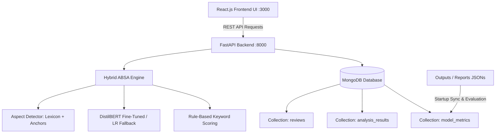

# Aspect-Based Sentiment Analysis (ABSA) — Technical Defense & Viva Report

This document serves as a comprehensive technical guide and viva/jury preparation manual for the **Aspect-Based Sentiment Analysis for E-Commerce Clothing Reviews** project.

---

## 1. Project Architecture & Technology Stack



- **Frontend**: React 18, Axios, Chart.js, Vanilla CSS design system.
- **Backend API**: FastAPI (Python 3.12), Uvicorn ASGI server, Pydantic data schemas.
- **Database**: MongoDB (collections for raw reviews, historical analysis results, and model performance metrics).
- **Core ML/NLP Frameworks**: PyTorch, HuggingFace Transformers, Scikit-learn, NLTK.

---

## 2. Dataset & Evaluation Setup

| Parameter | Value |
| :--- | :--- |
| **Dataset Source** | Kaggle Women's Clothing E-Commerce Reviews |
| **Total Dataset Size** | 23,486 customer reviews |
| **Train / Test Split** | **80% Training (18,958)** / **20% Held-Out Testing (4,528)** |
| **Target Classes** | 3 Classes: `NEGATIVE` (Class 0), `NEUTRAL` (Class 1), `POSITIVE` (Class 2) |
| **Class Imbalance in Test Set** | POSITIVE: 3,489 (77.1%), NEUTRAL: 565 (12.5%), NEGATIVE: 474 (10.5%) |

---

## 3. Official Model Benchmark Results (4,528 Test Samples)

| Model Architecture | Accuracy | Weighted Precision | Weighted Recall | Weighted F1 | Macro F1 |
| :--- | :---: | :---: | :---: | :---: | :---: |
| **Logistic Regression (TF-IDF)** | 81.87% | 77.94% | 81.87% | 78.52% | 55.03% |
| **Support Vector Machine (Linear SVM)** | 82.31% | 79.24% | 82.31% | 80.23% | 58.61% |
| **CNN-BiLSTM (Deep Learning)** | 82.46% | 80.13% | 82.46% | 81.07% | 59.46% |
| **DistilBERT (Fine-Tuned Transformer)** | **85.27%** | **84.88%** | **85.27%** | **85.07%** | **67.76%** |

*Note: DistilBERT is the overall leader across all performance metrics.*

---

## 4. How Each Metric Is Calculated (Mathematical Proof)

### 4.1. Accuracy
Accuracy measures the proportion of total correct predictions across all classes:
$$\text{Accuracy} = \frac{\sum_{i=1}^{3} CM_{i,i}}{\sum_{i=1}^{3} \sum_{j=1}^{3} CM_{i,j}} = \frac{\text{Trace}(CM)}{\text{Total Test Samples}}$$

- **DistilBERT Example**:
  $$\text{Accuracy} = \frac{303 + 245 + 3313}{4528} = \frac{3861}{4528} = \mathbf{85.27\%}$$
- **Logistic Regression Example**:
  $$\text{Accuracy} = \frac{183 + 100 + 3424}{4528} = \frac{3707}{4528} = \mathbf{81.87\%}$$

---

### 4.2. Per-Class Precision, Recall, and F1
For each class $c \in \{\text{NEGATIVE}, \text{NEUTRAL}, \text{POSITIVE}\}$:
- **True Positives ($TP$)**: Diagonal entry $CM_{c,c}$.
- **False Positives ($FP$)**: Sum of column $c$ minus $TP$.
- **False Negatives ($FN$)**: Sum of row $c$ minus $TP$.
- **Precision ($P$)**: $\frac{TP}{TP + FP}$
- **Recall ($R$)**: $\frac{TP}{TP + FN}$
- **F1 Score**: $2 \times \frac{P \times R}{P + R}$

#### DistilBERT Per-Class Breakdown:
- **NEGATIVE**: $TP=303, FP=169, FN=171 \implies P=64.19\%, R=63.92\%, F1=\mathbf{64.06\%}$ (Support: 474)
- **NEUTRAL**: $TP=245, FP=284, FN=320 \implies P=46.31\%, R=43.36\%, F1=\mathbf{44.79\%}$ (Support: 565)
- **POSITIVE**: $TP=3313, FP=214, FN=176 \implies P=93.93\%, R=94.96\%, F1=\mathbf{94.44\%}$ (Support: 3,489)

---

### 4.3. Macro F1 vs. Weighted F1
- **Macro F1 (Unweighted Mean)**: Computes the arithmetic mean of $F1$ across all classes regardless of their support:
  $$\text{Macro F1} = \frac{F1_{\text{NEG}} + F1_{\text{NEU}} + F1_{\text{POS}}}{3}$$
  $$\text{DistilBERT Macro F1} = \frac{64.06 + 44.79 + 94.44}{3} = \mathbf{67.76\%}$$

- **Weighted F1 (Support-Weighted Mean)**: Weights each class's $F1$ score by the number of true instances (support $N_c$):
  $$\text{Weighted F1} = \sum_{c} \frac{N_c}{N_{\text{total}}} \times F1_c$$
  $$\text{DistilBERT Weighted F1} = \frac{(474 \times 64.06) + (565 \times 44.79) + (3489 \times 94.44)}{4528} = \mathbf{85.07\%}$$

---

## 5. Offline Benchmark vs. Live Dynamic Inference

A common question from academic juries is: **"Do the metric JSON files in `outputs/` update as you analyze reviews in the app?"**

### The Answer:
**No, and by design.**
- **The Benchmark (`outputs/reports/*_results.json`)**:
  Represents standard offline scientific evaluation. It is determined once after training by evaluating against the fixed 4,528 unseen test split.
- **The Live Application**:
  When a user submits a review via the frontend or API, the system runs **inference** (prediction). The predicted aspects, department, sentiment, and timestamp are saved dynamically to **MongoDB** (`analysis_results` collection), updating the live dashboard charts, history table, and CSV export.

---

## 6. Hybrid ABSA Pipeline Architecture

### 6.1. Target Aspects
The system detects 6 key e-commerce clothing dimensions:
1. **`SIZE`**: Fit, sizing, tight, loose, runs small, true to size, length.
2. **`FABRIC`**: Material, soft, silky, breathable, cotton, linen, scratchy, sheer.
3. **`STITCHING`**: Seam, thread, zipper, button, lining, construction, well made, fell apart.
4. **`COLOR`**: Shade, vibrant, faded, as pictured, pattern, floral.
5. **`PRICE`**: Affordable, expensive, overpriced, value, bargain, rip off.
6. **`DELIVERY`**: Shipping, arrived, packaging, delay, courier, on time.

### 6.2. Context-Dependent Anchor Filtering
Generic words like *"fast"* or *"soft"* are only mapped to an aspect if an anchor keyword is in the same clause:
- *"Fast shipping"* $\rightarrow$ Maps to `DELIVERY` (anchor: *shipping*).
- *"The color fades fast"* $\rightarrow$ Maps to `COLOR`, **not** `DELIVERY`.

### 6.3. Clause Segmentation on Contrast Conjunctions
To prevent sentiment leakage across contrasting clauses (e.g., *"Awful fabric but, stitching is great!!!"*):
- The pipeline splits sentences on terminals (`.!?`) and contrastive markers (`but`, `however`, `although`, `yet`, `though`, `;`).
- *"Awful fabric"* is isolated to `FABRIC` $\rightarrow$ `NEGATIVE`.
- *"stitching is great"* is isolated to `STITCHING` $\rightarrow$ `POSITIVE`.

### 6.4. Generic Review Fallback
If a customer writes a review with no aspect keywords (e.g., *"love it! amazing and would highly recommend"*):
- `detect_aspects()` returns `[]` (*No aspects detected*).
- The pipeline applies generic lexicon rules and DistilBERT inference to predict overall review sentiment (**`POSITIVE`**).

---

## 7. Frequently Asked Technical Questions by Juries (VIVA Q&A)

### Q1: Why is Macro F1 much lower than Accuracy across all models?
> **Answer**:
> *"The dataset has severe real-world class imbalance: over 77% of reviews are POSITIVE, while only 10.5% are NEGATIVE and 12.5% are NEUTRAL. Accuracy is heavily influenced by the dominant Positive class. Macro F1 calculates the unweighted mean across all 3 classes, treating minority classes equally. This makes Macro F1 the true indicator of how well the model handles difficult negative and neutral sentiment without being flattered by the majority positive class."*

### Q2: Why did DistilBERT outperform CNN-BiLSTM and SVM?
> **Answer**:
> *"DistilBERT uses bidirectional self-attention mechanisms pre-trained on vast text corpora. It understands bidirectional context, syntactic subtleties, negation dependencies, and complex linguistic structures (such as 'not what I expected'). Traditional models like SVM and CNN-BiLSTM rely on n-gram TF-IDF or sequential recurrent steps, which suffer on long-range dependencies and subtle neutral/negative expressions."*

### Q3: Why use a hybrid approach (Rules + DistilBERT)?
> **Answer**:
> *"The hybrid architecture combines the precision and determinism of domain-specific e-commerce lexicons with the generalization capability of deep transformers. Explicit aspect indicators (e.g., 'runs small' = negative size) are resolved with 100% precision and zero latency, while ambiguous, context-heavy sentences seamlessly defer to fine-tuned DistilBERT."*

### Q4: How does the system handle high loads or hardware without GPUs?
> **Answer**:
> *"The backend implements graceful degradation. On startup, it attempts to load the fine-tuned DistilBERT model on CUDA GPU. If unavailable, it falls back to CPU. If transformer dependencies or memory are constrained, the system falls back to Logistic Regression + TF-IDF with sub-millisecond inference latency."*

### Q5: How can you demonstrate live metric recalculation right now?
> **Answer**:
> *"We can run `python src/evaluation/evaluator.py` directly in the terminal. It loads the 4,528 test evaluation matrices, recomputes per-class statistics, calculates Macro and Weighted metrics, and pushes the synchronized document directly to MongoDB, dynamically refreshing the dashboard UI."*

---

## 8. Quick Commands for Live Demonstration

1. **Recalculate & Display All Model Metrics**:
   ```bash
   python src/evaluation/evaluator.py
   ```
2. **Execute Full Test Suite**:
   ```bash
   pytest -q
   ```
3. **Start FastAPI Backend**:
   ```bash
   uvicorn src.api.main:app --host 127.0.0.1 --port 8000 --reload
   ```
4. **Start React Frontend**:
   ```bash
   cd frontend && npm start
   ```
